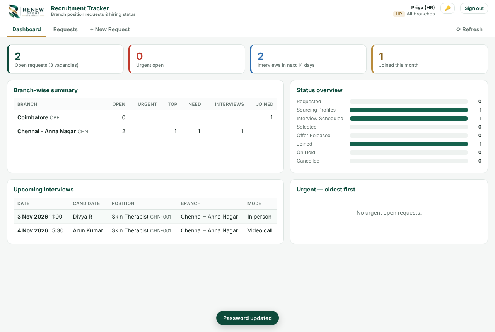

# Renew Group – Recruitment Tracker

A web app for tracking recruitment requests across all Renew Group branches.
Branch heads raise position requests, HR updates the progress (candidates, interview dates, status), and management sees a live, branch-wise dashboard.

Built on **Google Apps Script + Google Sheets**, so it is free to run, needs no server, and all data stays in a Google Sheet you own.



## Features

| | |
|---|---|
| **Position requests** | Branch heads raise requests with position, department, vacancies, experience, salary range, required-by date and a priority of **Urgent / Top Priority / Need**. |
| **Branch-wise serial numbers** | Generated automatically per branch, e.g. `CHN-001`, `CHN-002`, `CBE-001`. Only **HR and Admin** can change a serial number, and duplicates are blocked. Admin can also set the next serial number for each branch. |
| **HR status updates** | Statuses are Requested → Sourcing Profiles → Interview Scheduled → Selected → Offer Released → Joined, plus On Hold and Cancelled. HR can also add remarks that the branch head can see. |
| **Candidates & interviews** | HR adds candidate names, phone numbers, interview date and time, mode, interviewer, stage and remarks. The request's status moves forward automatically (for example, it changes to *Interview Scheduled* when an interview date is added). |
| **Dashboard** | Shows open requests and vacancies, urgent requests, interviews in the next 14 days, joinings this month, a branch-wise summary, a status overview and the oldest urgent requests. |
| **Requests list** | Search and filter by branch, status and priority. You can show or hide closed requests, see each request's age in days, and export to CSV. |
| **Activity history** | Every change is logged with who made it and when (for example, *Status: Sourcing → Interview Scheduled*). |
| **Roles** | Admin, HR and Head. A head can be assigned more than one branch. |
| **Mobile friendly** | Works on phones, so branch heads can check status on the go. |

### Who can do what

| Action | Head | HR | Admin |
|---|:-:|:-:|:-:|
| Raise a request (own branch) | ✅ | ✅ (any branch) | ✅ (any branch) |
| See requests | Own branch(es) | All | All |
| Edit request details / priority | ✅ until closed | ✅ | ✅ |
| Change status, HR remarks | – | ✅ | ✅ |
| Change serial number | – | ✅ | ✅ |
| Add / edit candidates & interview dates | – | ✅ | ✅ |
| Manage branches & users, delete requests | – | – | ✅ |

## Setup (about 10 minutes)

1. **Create the Google Sheet.** Go to [sheets.new](https://sheets.new) and name it `Recruitment Tracker`.
2. **Add the code.** In the sheet, open **Extensions → Apps Script**, then:
   - Replace the contents of `Code.gs` with [`src/Code.gs`](src/Code.gs).
   - Click **+ → HTML**, name the file `Index`, and paste [`src/Index.html`](src/Index.html).
   - Under **Project Settings**, tick *Show "appsscript.json" manifest file* and paste [`src/appsscript.json`](src/appsscript.json).
3. **Run setup.** Select the `setup` function, click **Run**, and approve the permissions.
   This creates the sheets *Branches, Users, Requests, Candidates* and *History*, and your first Admin login:
   - **Email:** your Google account email
   - **Password:** `Admin@123` (you'll be asked to change it the first time you sign in)
4. **Deploy.** Click **Deploy → New deployment → Web app** and choose:
   - *Execute as:* **Me**
   - *Who has access:* **Anyone** (the app has its own login and roles)

   Copy the web app URL and share it with HR and the branch heads.
5. **Add your branches and users.** Sign in as Admin, open the **Admin** tab and:
   - Add each branch with a short code. The code is used in serial numbers, for example `CHN – Chennai`.
   - Add HR users and branch heads. Give each head their branch(es) and a temporary password, which they'll change when they first sign in.

> When you change the code later, use **Deploy → Manage deployments → Edit → New version** so the same URL keeps working.

### Optional: deploy from GitHub with `clasp`

```bash
npm install -g @google/clasp
clasp login
cp .clasp.json.example .clasp.json   # paste the Script ID from Apps Script → Project Settings
clasp push                           # uploads src/ to Apps Script
clasp deploy                         # creates a new web-app version
```

## Put this project on GitHub

```bash
cd renew-recruitment-tracker
git remote add origin https://github.com/<your-account>/renew-recruitment-tracker.git
git branch -M main
git push -u origin main
```

(Create the empty repository on github.com first. Make it **Private** if you prefer.)

## Data & security notes

- All data lives in your Google Sheet. You can view it, filter it or back it up like any other sheet. Avoid editing the `ID` columns or the `Users` password columns by hand.
- Passwords are stored as salted SHA-256 hashes, never as plain text.
- Sessions expire after 6 hours of inactivity.
- After 5 wrong passwords, that login is locked for 15 minutes.
- Only Admins can reset passwords (in the Admin tab, under *Users → Edit → Reset password*).

## Project structure

```
src/Code.gs          Apps Script backend (data, roles, serial numbers, history)
src/Index.html       Single-page front end (dashboard, requests, admin)
src/appsscript.json  Manifest (time zone Asia/Kolkata, web-app settings)
docs/                Screenshots
```

---
Created by Zelora Infotech for Renew Group of Companies.
